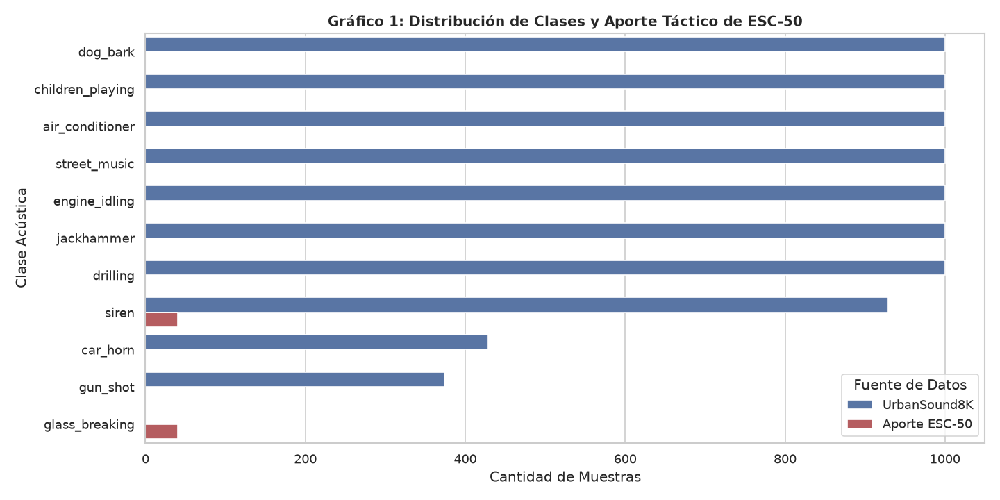
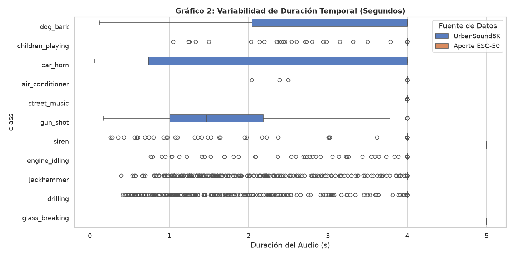
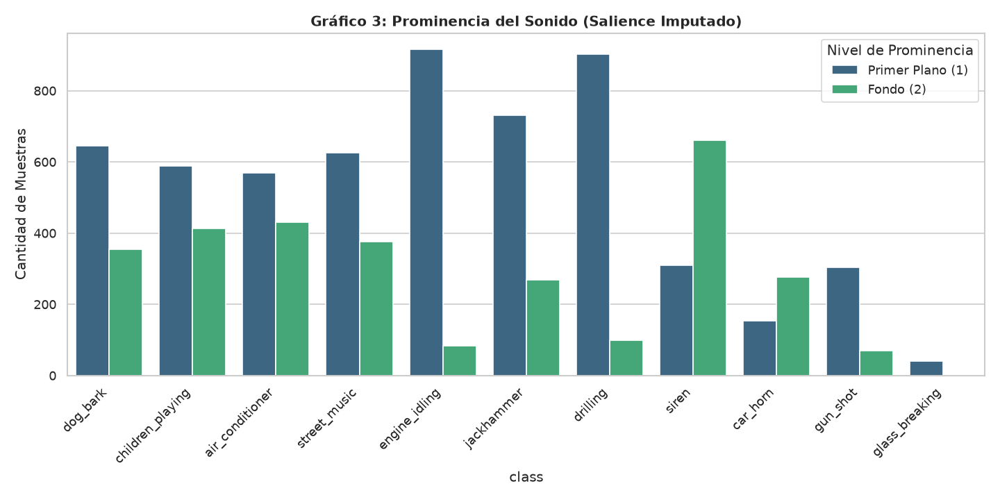
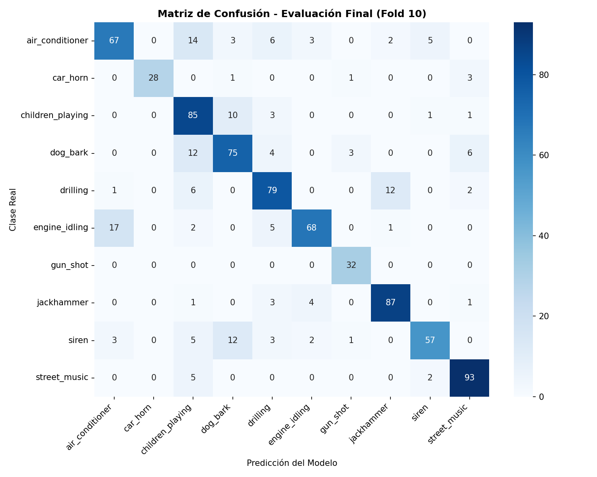

# 🛡️ Sistema de detección y generación de alertas tempranas ante incidentes balísticos y siniestros viales en entornos urbanos para la respuesta y despliegue eficaz de personal policíal y médico 

> **Curso:** Aprendizaje Profundo (Deep Learning)  
> **Perfil:** Ingeniería en Ciencia de Datos   
> **Estudiantes:** Anthoni Hernández, Laura Ortiz, Andrés Marín, Angie Boada.
---

## 📋 Tabla de Contenidos
1. [Planteamiento del Problema y Justificación](#1-planteamiento-del-problema-y-justificación)
2. [Taxonomía Operativa y Fusión de Clases](#2-taxonomía-operativa-y-fusión-de-datasets)
3. [Análisis Exploratorio de Datos y Auditoría](#3-análisis-exploratorio-de-datos-y-auditoría)
4. [Ingeniería de Señales y Estrategia contra Data Leakage](#4-ingeniería-de-señales-y-estrategia-contra-data-leakage)
5. [Arquitectura Base del Modelo y Referentes Teóricos](#5-arquitectura-base-del-modelo-y-referentes-teóricos)
6. [Conclusiones Preliminares y Próximos Pasos](#6-conclusiones-preliminares-y-próximos-pasos)

---

## 1. Planteamiento del Problema y Justificación

### El Reto de la Latencia en Entornos Urbanos Globales
En las ciudades modernas, los tiempos de respuesta ante incidentes críticos dependen de que un ciudadano presencie el suceso, se comunique con una línea de emergencia y logre describir su ubicación exacta. Esta cadena manual introduce una latencia operativa de varios minutos, un margen fatal en situaciones de riesgo inminente. A diferencia de sonidos estructurados como la voz humana o la música, el sonido ambiental urbano es mucho más complejo, pues contiene altos niveles de ruido de fondo, silencios y múltiples eventos superpuestos que dificultan su clasificación automática.

### Sistema de Seguridad Táctica Automatizada
Este proyecto implementa una prueba de concepto (PoC) mediante aprendizaje profundo para transformar redes de micrófonos urbanos en un **sistema de alerta temprana** orientado estrictamente a la seguridad y respuesta operativa. El sistema cubre tres frentes críticos para plataformas de Smart Cities globales:
1. **Detección de Amenazas Activas:** Identificación instantánea de detonaciones balísticas (`gun_shot`) para el despacho inmediato y geolocalizado de unidades de policía.
2. **Respuesta a Siniestros Viales:** Detección automática de colisiones y accidentes de tránsito para despachar redes de ambulancias en los primeros segundos del impacto, sin depender de reportes ciudadanos.
3. **Gestión Dinámica de Emergencias (Telemetría Acústica):** Rastreo del desplazamiento de vehículos de emergencia (`siren`) para habilitar la preempción semafórica ("olas verdes"), despejando corredores viales automáticamente.

---

## 2. Taxonomía Operativa y Fusión de Datasets

Dado que el benchmark estándar (`UrbanSound8K`) carece de registros de siniestralidad vial, este proyecto ejecuta una fusión de datos (*Data Fusion*), integrando el corpus principal con un dataset complementario (`ESC-50`) para incorporar la clase de accidentes de tránsito y rotura de cristales.

Para optimizar el rendimiento del modelo, el espectro acústico se reestructura en un esquema de **priorización binaria operativa**, agrupando las clases combinadas en dos niveles de criticidad:

| Nivel Operativo | Clases Involucradas | Propósito Táctico y Firma Acústica |
| :--- | :--- | :--- |
| **Nivel 1: Alerta Táctica (Acción Inmediata)** | `gun_shot`, `car_crash`, `siren`, `glass_breaking` | Activar protocolos de despacho policial, médico o control semafórico. Acústicamente requieren identificar sonidos transitorios rápidos (disparos y colisiones) y eventos armónicos continuos (sirenas). |
| **Nivel 2: Ruido Urbano Basal (Control Negativo)** | `car_horn`, `dog_bark`, `jackhammer`, `engine_idling`, música, etc. | Ruidos ambientales, maquinaria e interacciones viales normales. Actúan como clase de absorción (confusores) para entrenar la especificidad de la red y asegurar la supresión de falsas alarmas. |

---

## 3. Análisis Exploratorio de Datos y Auditoría

El proyecto se fundamenta en la fusión de dos datasets estándar de la industria acústica: **UrbanSound8K** (8,732 extractos de hasta 4 segundos) y **ESC-50** (2,000 audios exactos de 5 segundos). Del análisis exploratorio conjunto se desprenden los siguientes retos para el diseño experimental:

- **Desbalance y Enriquecimiento de Clases:** En UrbanSound8K, la clase crítica `gun_shot` posee únicamente 374 muestras, mientras que la mayoría superan los 900 registros. La integración con ESC-50 permite inyectar nuevas muestras tácticas (siniestros y cristales rotos) para robustecer el modelo, aunque el desbalance subyacente justifica el uso posterior de funciones de pérdida ponderadas (`Focal Loss`).
- **Variabilidad de Duración y Formato:** Mientras que ESC-50 garantiza audios estandarizados de 5 segundos de duración, UrbanSound8K presenta una alta variabilidad temporal, donde las detonaciones ocurren en lapsos transitorios inferiores a 1.5 segundos.
- **Metadato de Prominencia (`salience`):** UrbanSound8K distingue entre sonidos en primer plano (`salience = 1`) y de fondo (`salience = 2`). Al fusionar los datos, es imperativo imputar o estandarizar este comportamiento para las pistas provenientes de ESC-50.
 
> **Evidencia Gráfica del EDA:**  
> *(Los gráficos generados con el script exploratorio se encuentran en la raíz del repositorio)*  
> *   
> *   
> * 

---

## 4. Ingeniería de Señales y Estrategia contra Data Leakage

Para garantizar la validez científica y unificar arquitectónicamente ambas fuentes, se implementó un pipeline estricto de Procesamiento Digital de Señales (DSP) en Python utilizando `librosa`:

1. **Prevención de Data Leakage Multifuente:** Se respetó la estructura de validación cruzada original de ambos repositorios: los 10 folds preasignados en UrbanSound8K y los 5 folds propios de ESC-50. Las muestras tácticas filtradas de ESC-50 se inyectan exclusivamente en los folds de entrenamiento de UrbanSound8K, manteniendo un conjunto de prueba hermético.
2. **Estandarización de Frecuencia:** Para resolver las diferencias de grabación, todos los archivos `.wav` se unificaron a un canal (mono) y se remuestrearon forzosamente a una frecuencia de $\text{sr} = 22050\text{ Hz}$.
3. **Recorte y Zero-Padding Centrado:** Se fijó una duración temporal estricta de $4.0\text{ segundos}$ ($88,200\text{ muestras}$). Los audios de ESC-50 (5 segundos) fueron recortados; simultáneamente, los audios cortos de UrbanSound8K se rellenaron con ceros de forma centrada para evitar la distorsión de los transitorios balísticos en los bordes del tensor.
4. **Transformada a Espectrograma de Mel:** Conversión de la señal 1D a un tensor bidimensional logarítmico de $(128 \text{ bandas Mel} \times 173 \text{ marcos temporales})$, proyectando la física del sonido a un formato de imagen compatible con redes convolucionales (`Conv2D`).

---

## 5. Arquitectura Base del Modelo y Referentes Teóricos

Inspirados en la literatura científica reciente sobre clasificación de sonidos ambientales, específicamente en arquitecturas con mecanismos de atención temporal-frecuencia, el sistema adopta una **Red Neuronal Convolucional (CNN)** como columna vertebral (*backbone*):

- **Justificación de la Arquitectura:** La naturaleza de los sonidos determina su procesamiento. Los sonidos transitorios (disparos, choques) dependen fuertemente de marcos temporales discretos para ser identificados. Por el contrario, los sonidos continuos (sirenas) se benefician de una alta discriminación en bandas de frecuencia específicas.
- **Bloques Convolucionales:** El modelo consta de capas sucesivas de `Conv2D`, `BatchNormalization`, `ReLU` y `MaxPooling2D` diseñadas para extraer patrones espacio-temporales de los espectrogramas, cerrando con un estrato de `GlobalAveragePooling2D` para lograr invarianza a la posición temporal del evento (independientemente de en qué segundo exacto ocurrió la emergencia).

---

## 6. Conclusiones Preliminares y Próximos Pasos

- **Viabilidad del Proyecto:** Se confirmó que la fusión estratégica de `UrbanSound8K` y las clases tácticas de `ESC-50` resulta en un corpus acústico robusto pero lo suficientemente ligero computacionalmente para ser entrenado en entornos de GPU en la nube (ej. Google Colab) dentro de los plazos del curso.
- **Limitación de Propagación:** Ambos datasets provienen de recolecciones heterogéneas y no de sensores físicos calibrados en altura urbana; esta limitación se documenta formalmente como supuesto operativo para la fase PoC.
- **Próximos Pasos (Segunda Entrega):** Programación del script de fusión de datos (`Data Fusion`), construcción del generador de lotes de memoria eficiente (`tf.data`), compilación de la red CNN en Keras, y calibración del umbral de decisión táctico ($\tau$) para minimizar las omisiones críticas.

- ---

## Artefactos y Almacenamiento en la Nube (Google Drive)

Debido a las políticas de tamaño de archivo en GitHub, los tensores espectrales procesados y los pesos entrenados de la red neuronal se alojan en Google Drive para su reproducción directa:

* **Carpeta del Proyecto (`Proyecto_Acustico_Tensores`):** [Acceder a Tensores y Modelo Entrenado en Google Drive](https://drive.google.com/drive/folders/1EJQkkQz_qaGusBJuN-B9SWsQFIHfxRtZ?usp=sharing)
  * `X_mel.npy` y `y_labels.npy`: Matrices de espectrogramas logarítmicos de Mel `(8812, 128, 173, 1)` y etiquetas codificadas.
  * `folds.npy` y `mapa_clases.json`: Partición estratificada por *folds* y diccionario de clases.
  * `mejor_modelo_cnn_tactico.keras`: Pesos óptimos de la CNN 2D restaurados en la época 15 mediante `EarlyStopping`.

---

## Arquitectura del Modelo y Entrenamiento

* **Entrada:** Tensores visuales de espectrogramas de Mel `(128 × 173 × 1)` estandarizados mediante *Z-score* calculado exclusivamente sobre entrenamiento.
* **Arquitectura:** Red Neuronal Convolucional 2D (`Conv2D`) de 4 bloques con `BatchNormalization`, `MaxPooling2D`, `Dropout` progresivo y `GlobalAveragePooling2D`.
* **Función de Pérdida:** *Focal Loss* ($\gamma = 2.0$) para mitigar el desbalance de las clases tácticas minoritarias.
* **Partición sin *Data Leakage*:** Entrenamiento en *folds* `0`–`8` (incluyendo los aportes tácticos de ESC-50 en `fold = 0`), validación en `fold = 9` y evaluación final aislada en `fold = 10` (837 grabaciones inéditas).

---

## Resultados Experimentales (Evaluación en Fold 10)

El modelo alcanzó una **exactitud global del 80.17 %** (671 aciertos de 837 muestras) sobre entornos acústicos nunca vistos durante el entrenamiento[cite: 25]:

| Clase Acústica | Categoría Operativa | Precision | Recall (Sensibilidad) | F1-Score | Muestras (Fold 10) |
| :--- | :--- | :---: | :---: | :---: | :---: |
| **`gun_shot`** | **Peligro Inmediato** | **86.49 %** | **100.00 %** | **92.75 %** | **32** |
| **`siren`** | **Peligro Inmediato** | **87.69 %** | **68.67 %** | **77.03 %** | **83** |
| `car_horn` | Ruido Basal / Alerta Vial | 100.00 % | 84.85 % | 91.80 % | 33 |
| `street_music` | Ruido Basal / Urbano | 87.74 % | 93.00 % | 90.29 % | 100 |
| `jackhammer` | Ruido Basal / Urbano | 85.29 % | 90.62 % | 87.88 % | 96 |
| `engine_idling` | Ruido Basal / Urbano | 88.31 % | 73.12 % | 80.00 % | 93 |
| `drilling` | Ruido Basal / Urbano | 76.70 % | 79.00 % | 77.83 % | 100 |
| `dog_bark` | Ruido Basal / Urbano | 74.26 % | 75.00 % | 74.63 % | 100 |
| `children_playing` | Ruido Basal / Urbano | 65.38 % | 85.00 % | 73.91 % | 100 |
| `air_conditioner` | Ruido Basal / Urbano | 76.14 % | 67.00 % | 71.28 % | 100 |

### Evidencia Gráfica: Matriz de Confusión

* **Hallazgo Táctico Principal:** La combinación de *zero-padding* centrado y *Focal Loss* permitió detectar **el 100 % de los disparos reales (`gun_shot`)** sin omisiones, manteniendo una precisión superior al 86 % tanto en detonaciones como en sirenas de emergencia (`siren`).
